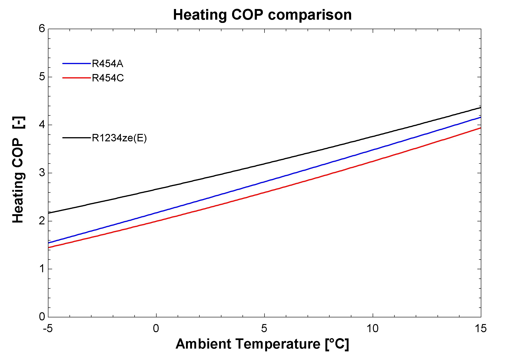
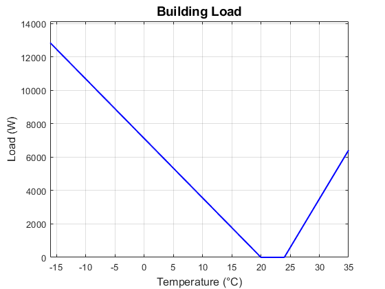
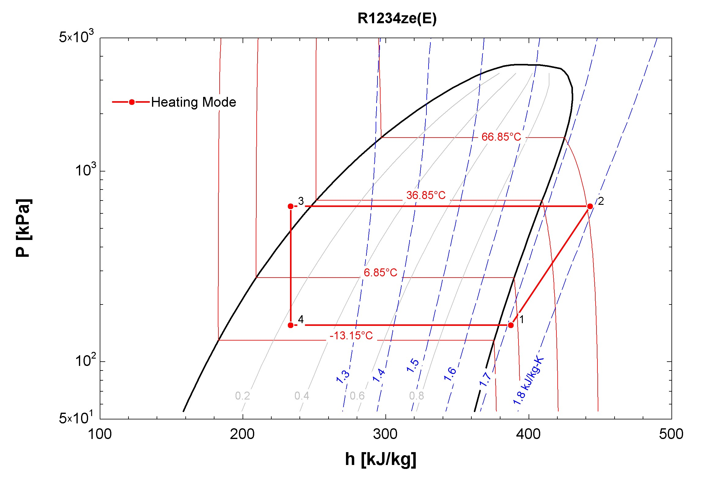
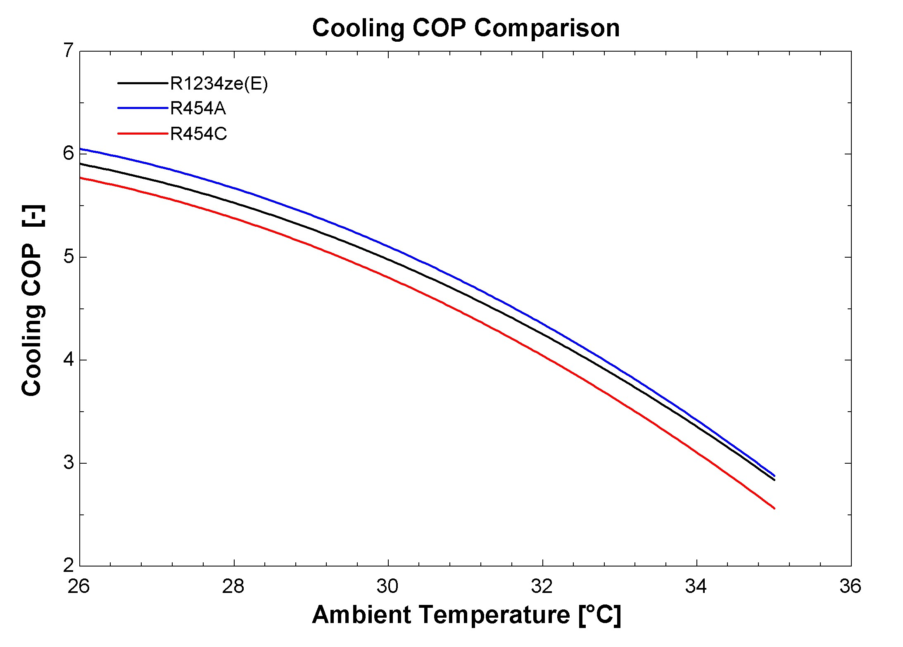

# Low-GWP Refrigerants for a Cold-Climate Residential Heat Pump

**Which low global-warming-potential refrigerant holds heating performance when it is cold outside?**
A single-stage, variable-speed residential heat pump for a Chicago house, modeled in
[EES](https://fchartsoftware.com/ees/) from building load through component sizing to
seasonal performance.

*ME 518 (HVAC), Purdue University, Fall 2024. Individual project.*



## Results

| | Value |
|---|---|
| Heating load at the 0 °C sizing point | **7.1 kW** (about 12.8 kW at the −16.1 °C ASHRAE 99% design) |
| Design cooling load (31.9 °C, ASHRAE 1%) | **4.6 kW**, sensible heat ratio 0.83 |
| Estimated HSPF (at 4,100 rpm) | **12.4**, US minimum 8.8 |
| Estimated SEER (at 1,950 rpm) | **15**, US minimum 14.3 |
| Linearized compressor mass-flow model vs. manufacturer data | within **5%** |

- **R-1234ze(E) gives clearly higher heating COP across the whole range**, and the gap widens
  as it gets colder: about 2.2 at −5 °C against roughly 1.5 for R-454A and R-454C.
- Cooling COP is similar for all three, with R-454A slightly ahead.
- In a cold climate, heating performance should therefore drive the refrigerant choice.

## Method

1. **Building load.** ASHRAE Residential Load Factor method (Handbook, Ch. 17) for a
   2,100 ft² (195 m²) one-story house in Chicago: envelope, infiltration, internal gains and
   distribution losses, linearized into heating and cooling load lines.
   See [`load/building_load_calculation.xlsx`](load/building_load_calculation.xlsx).
2. **Compressor selection.** Variable-speed scroll compressor (1,200 to 7,200 rpm) chosen with
   Copeland Select 8 to meet the heating load at 0 °C with A2L refrigerants
   (heating, not cooling, sets the size in this climate). The manufacturer
   gives a 20-coefficient power map but only a 10-coefficient mass-flow map at nominal speed,
   so mass flow was scaled linearly with speed and checked against the tool's off-nominal
   values (within 5%). See [`model/compressor_vs.lib.txt`](model/compressor_vs.lib.txt).
3. **Heat exchanger sizing.** Lumped ε-NTU models of the condenser and evaporator, sized by
   parametric study to hit the design loads with 5 to 10 °C subcooling.
   See [`model/condenser_sizing.ees.txt`](model/condenser_sizing.ees.txt) and
   [`model/evaporator_sizing.ees.txt`](model/evaporator_sizing.ees.txt).
4. **System performance.** Full cycle in heating and cooling mode, swept over outdoor
   temperature and compressor speed for each refrigerant.
   See [`model/heating_mode.ees.txt`](model/heating_mode.ees.txt) and
   [`model/cooling_mode.ees.txt`](model/cooling_mode.ees.txt).

| Building load lines | R-1234ze(E) cycle, heating mode |
|---|---|
|  |  |



## Repository layout

```
model/
  heating_mode.ees.txt        system model, heating mode
  cooling_mode.ees.txt        system model, cooling mode
  compressor_vs.lib.txt       variable-speed scroll compressor procedure
  condenser_sizing.ees.txt    indoor/outdoor coil sizing (condensing)
  evaporator_sizing.ees.txt   indoor/outdoor coil sizing (evaporating)
load/
  building_load_calculation.xlsx   ASHRAE RLF load calculation
figures/
```

## Running it

The models are EES equation files saved as plain text so they can be read on GitHub.
To run one, paste it into a new EES window (or open it and save as `.EES`) with the
component procedures in the same folder.

The system models `$Include` two component procedures, `Evaporator_SI.lib` and
`Condenser_SI.lib`. These were supplied with the course and are not redistributed here.
Any lumped ε-NTU evaporator and condenser procedure with the same call signature will work:

```
CALL evaporator_si(R$, T_eai, T_wbi, m_dot_r, T_evap, DELTAT_sup : P_evap, h_1, h_4, Q_evap, T_eao, SHR)
CALL condenser_si(R$, T_cai, m_dot_r, T_cond, DELTAT_sub : P_cond, h_2, h_3, Q_cond, T_cao)
```

The compressor curve-fit coefficients in `compressor_vs.lib.txt` came from Copeland Select 8.
The raw software exports are not included.

## Limitations

- Single-stage cycle; quasi-two-stage and suction-line heat exchanger options were not modeled.
- Pressure drops are neglected and coils are treated as lumped.
- Subcooling was set relatively high; performance at lower subcooling is untested.
- Seasonal ratings are estimated at representative conditions, not by a full AHRI 210/240 procedure.

## Author

**Jose Ernesto Sandoval Hernandez**, MSc Mechanical Engineering, Purdue University
· [LinkedIn](https://www.linkedin.com/in/jsahe) · [Google Scholar](https://scholar.google.com/citations?user=cL2oeXIAAAAJ&hl=en)
